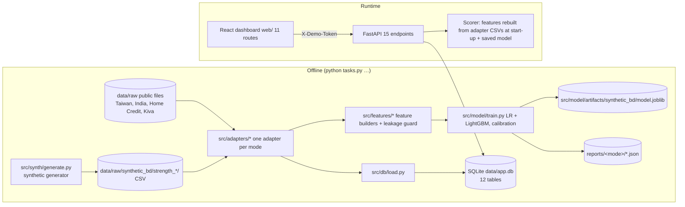

# CredLens: End-to-End Product, Technical, Data and Model Audit

Audit date: 31 October 2026. Read-only audit of `E:\CredLens\CredLens`.
Nothing in the application, the models, the datasets or the database was changed to produce
this report; the only file written is this one.

Evidence labels used throughout:

| Label | Meaning |
|---|---|
| **VERIFIED** | Established directly from the code, a database read, a file listing or a test run |
| **PARTIALLY VERIFIED** | The implementation exists, but complete operation is not proven |
| **UNVERIFIED** | Not enough evidence, or the resource could not be inspected |
| **NOT IMPLEMENTED** | No implementation found |
| **SIMULATED** | Synthetic or demonstration behaviour |

---

## 1. Executive summary

1. **No development commit exists.** The working branch `platform-modification`, the local
   `main` and the last-fetched `origin/main` all point at the same commit, `43dcc00`
   (18 Oct 2026). Every change made since then (the implementation-pack phases, the product
   redesign and Workstreams A to G) is **uncommitted** in the working tree: 52 modified
   files, 2 deleted files and 81 new files (about +7,300 / −1,850 lines in tracked files and
   about 16,000 lines in new files). Git therefore cannot separate the implementation-pack
   work from Workstreams A–G; that attribution in this report comes from the session record
   and `docs/HANDOVER.md` sections 0 and 0a (**PARTIALLY VERIFIED**).
2. **What existed at `43dcc00`:** a complete research-grade pipeline. It had a synthetic
   Bangladesh retailer generator (20,000 merchants), five data modes (one synthetic, four
   public real-label datasets), behaviour-only feature engineering with a leakage guard,
   logistic regression and LightGBM with sign/monotone constraints, calibration, a 0–100
   score with coverage and bands, exact Shapley reasons, fairness and ablation reports,
   a FastAPI API with 15 endpoints and demo roles, append-only decisions and audit, and a
   React dashboard with 11 routes.
3. **What was added:** a working evidence-collection workflow (Field Mode), an officer
   workspace, Excel import, organisation scoping, a provider-independent source registry with
   one **synthetic** sandbox connector, merchant matching, a data-quality review system, a
   redesigned dashboard and public site, and a database upgrade tool. The API grew from 15
   to 52 endpoints; the schema from 12 to 24 tables. **The scoring method, the model and the
   training pipeline were not changed** (the model file and its metadata are byte-identical
   to the commit, hash prefix `a9fcc5d3`).
4. **What CredLens can do today (VERIFIED in the browser and by tests, sandbox only):**
   - an officer can register a shop, record simulated consent and enter or import evidence;
   - the shop is assessed by the trained model, with exact reasons and evidence coverage;
   - data-quality issues are surfaced for review, and a human decision is recorded
     (append-only, audited);
   - it runs only on synthetic data, with demo identities.
5. **Most serious gaps:**
   - **Authentication is a demo.** The user id itself is the credential, and the ids are
     printed on the public sign-in page.
   - **The model is trained and validated on synthetic data only.**
   - **No real provider integration exists.** Mokam/ShopUp, Baki and REDX are catalogue
     entries marked "planned".
   - **No organisation or user management.**
   - **Records entered by staff are unverified, yet they move the score directly.**
   - **No frontend tests.**

---

## 2. Repository baseline and branch comparison

| Item | Value | Status |
|---|---|---|
| Current branch | `platform-modification` | VERIFIED (`git branch`) |
| Current HEAD | `43dcc0018b9338d3debead5a0c57160fe95eedea` ("Merge pull request #24 … docs/pilot-plan-and-access", 2026-10-18 00:48 +0600) | VERIFIED |
| Default branch | `main` (`refs/remotes/origin/HEAD -> origin/main`) | VERIFIED |
| Local `main` HEAD | `43dcc00…` (same) | VERIFIED |
| `origin/main` (last fetch) | `43dcc00…` (same) | VERIFIED locally; **not fetched**, so the remote may have moved since the last fetch (UNVERIFIED) |
| Merge-base (`main`, HEAD) | `43dcc00…` | VERIFIED |
| Commits on the development branch | **none** (`git log main..HEAD` is empty) | VERIFIED |
| Commits on `main` not on the branch | none | VERIFIED |
| Working tree clean? | **No.** 52 modified (M), 2 deleted (D), 81 untracked (??) | VERIFIED (`git status --porcelain`) |
| Partially staged files | none (nothing is staged) | VERIFIED |
| Ignored paths present | `.venv/`, `data/app.db`, `data/backups/`, `data/exports/`, `data/raw/`, `web/dist/`, `web/node_modules/`, caches | VERIFIED (`git status --ignored`) |
| Remote | `https://github.com/Zamila18/CredLens.git`; 23 remote branches, all feature/docs branches already merged into `main` by PRs | VERIFIED (listing only) |

**Comparison A (original baseline → current development state)** and **comparison B
(current `main` → current development state)** give the same result: the branch has no
commits, and `main` has not moved since the merge-base. Every difference lives in the
uncommitted working tree.

Change-type summary (comparison against `43dcc00`):

| Area | Change |
|---|---|
| Dependencies | `requirements.txt`: added `openpyxl~=3.1.5` (Excel import). No frontend dependency added in `web/package.json`. |
| Configuration | `config/default.yaml` +48 lines: `organization`, `demo` (calendar, synthetic-only, consent, application, visit, purchase-import), `review` (evidence requests, range policy off), `quality`. `src/config.py` +45 lines of validation. |
| Database schema | `src/db/models.py` +438/−21: 12 new tables, 2 new nullable columns, append-only triggers for 6 more tables. New `src/db/upgrade.py` (additive upgrade tool). |
| API endpoints | 15 → 52; **none removed** (§13, Appendix B). |
| Auth/authz | `src/api/auth.py`: `CurrentUser.organization_id` added; the mechanism itself (demo token) is **unchanged**. New `src/api/tenancy.py`: an organisation guard on every `{merchant_id}` route. |
| Frontend | 11 → 34 route paths; `HomePage.tsx` and `Banner.tsx` deleted (replaced by the public site and the new shell). |
| Model/scoring | `src/model/scoring.py` +3 lines (no method change); new `src/model/operating_points.py` (an analysis report only). The model artifact is unchanged. |
| Tests | 45 → 51 test files; 772 → 872 test functions. |

Appendix A lists every changed file.

---

## 3. Original CredLens architecture (at `43dcc00`)



- The **Scorer** reads the benchmark data through the **adapter CSV files**, not the
  database. It does this once at start-up (`src/model/scoring.py:83-104`). The database
  holds the same rows for listing, consent, decisions and audit (VERIFIED).
- **Roles:** `officer`, `admin`, `viewer` (`src/api/auth.py:32-34`). The user picks a demo
  identity and sends it in `X-Demo-Token` (VERIFIED, unchanged since baseline).

---

## 4. Original dataset inventory

No dataset contents were opened beyond file names, sizes and headers already documented in
the repository. No personal records are reproduced here.

| Dataset | Location | Size | Kind | Purpose | Tracked in Git | Present now | Changed? |
|---|---|---|---|---|---|---|---|
| Synthetic Bangladesh retailers (`synthetic_bd`), signal strengths 0 / 0.5 / 1 | `data/raw/synthetic_bd/strength_*/` (merchants, purchases, deliveries, payments, loans, questionnaire, consents CSV, `_meta.json`, `_latent_truth.csv`) | 577 MB | SYNTHETIC (generated by `src/synth/generate.py`, seed 42) | Training, evaluation, runtime benchmark scoring | No (ignored; regenerated by `python tasks.py data`) | Yes | No (VERIFIED by timestamps and the unchanged model metadata) |
| Taiwan credit-card default | `data/raw/taiwan_cc/default of credit card clients.xls` | 5.3 MB | PUBLIC (UCI) | Real-label check (`taiwan_cc` mode) | No | Yes | No |
| India L&T vehicle loans | `data/raw/india_ltfs/train.csv`, `data_dictionary.csv` | 40 MB | PUBLIC (Kaggle) | Real-label check | No | Yes | No |
| Home Credit | `data/raw/homecredit/` (application, instalments, POS cash) | 1.2 GB | PUBLIC (Kaggle; rows may never be shown) | Real-label check | No | Yes | No |
| Kiva snapshot | `data/raw/kiva/kiva_ds_json.zip` + `_derived` | 1.2 GB | PUBLIC | Real-label check (shown not usable) | No | Yes | No |
| Global Findex 2025 | `data/raw/findex/GlobalFindexDatabase2025.csv` | 17 MB | PUBLIC | Calibration figures for the generator | No | Yes | No |
| World Bank informal-sector query | `data/raw/wb_informal/…xlsx` | 32 KB | PUBLIC | Generator calibration | No | Yes | No |
| Demo bundle | `data/demo/*.csv`, `credlens_demo_bundle.zip`, `EXPECTED.md` | small | SYNTHETIC | Admin "Data files" import demonstration | **Yes** | Yes | No |
| API sample fixtures | `tests/fixtures/api/` | small | SYNTHETIC | Contract tests | Yes | Yes | No |
| Mifos export | `data/exports/mifos/` | — | SYNTHETIC-derived | Mifos X compatibility check | No | Yes | No |
| Nested copy of an older data folder | `data/raw/data/data/` (includes an old `app.db` and backup) | **3.7 GB** | Mixed copy | None found (no code refers to it) | No | Yes | Appears to be an accidental duplicate (UNVERIFIED origin) |
| Empty folder skeleton | `data/data/` | ~0 | — | None | No | Yes | Unknown origin |

ShopUp/Mokam data was **never obtained** (`CLAUDE.md`; `src/adapters/shopup_real.py`
raises `NotImplementedError` in every method). VERIFIED.

---

## 5. Original models and algorithms

| Component | Implementation | Status |
|---|---|---|
| Synthetic generator | `src/synth/generate.py` (739 lines): merchants with latent quality, purchases, parcels, loans, repayments, questionnaire, consents; delivery "signal strength" knob | VERIFIED |
| Adapters | `src/adapters/factory.py`: `synthetic_bd → ShopUpSyntheticAdapter`, `taiwan_cc`, `india_ltfs`, `homecredit`, `kiva_asia`; `shopup_real.py` stub | VERIFIED |
| Feature engineering | `src/features/build_features.py`: per-loan features using only events strictly before the loan's issue date (`events_before_cutoff`); public-mode builders in `src/features/<mode>.py`; leakage tests `src/features/leakage.py` and `tests/test_leakage.py` | VERIFIED |
| Labels | `src/model/labels.py`: label 1 when every due payment was made within 30 days of due date; loans younger than 60 days have no label | VERIFIED |
| Split | `src/model/split.py`: by time (12 / 3 / 3 months); stratified random for public modes without dates (marked weaker) | VERIFIED |
| Candidate 1 | Logistic regression: `SimpleImputer(mean)` → `StandardScaler` → `LogisticRegression` (`src/model/train.py:92-97`). Inputs whose fitted weight contradicts the expected direction are removed and refitted (`fit_with_expected_directions`, `train.py:104`) | VERIFIED |
| Candidate 2 | LightGBM with monotone constraints (`src/model/boosted.py:71-72`), tuned inside the training period | VERIFIED |
| Model choice rule | LR stays unless LightGBM's AUC gain range clears +0.01 (`choose_model`, `train.py:260`) | VERIFIED |
| Calibration | `src/model/calibrate.py`: none / Platt / isotonic, chosen on validation | VERIFIED |
| Evaluation | `src/model/evaluate.py`, `final_test.py` (test months used once, logged in `reports/<mode>/test_set_use.json`), bootstrap ranges (500 resamples) | VERIFIED |
| Fairness | `src/model/fairness.py`; group columns are audit-only; `reports/FAIRNESS.md` | VERIFIED |
| Ablation | `src/model/ablation.py`; `reports/ablation/` | VERIFIED |
| Explainability | `src/model/explain.py`: **exact Shapley values** against an "average merchant" baseline, computed over every input order (≤14 inputs); a test compares them with the SHAP library's exact explainer | VERIFIED |
| Plain summary | `plain_summary` (`explain.py:293`): **template sentences** built from the card's numbers (no language model) | VERIFIED |

**Trained artifacts:** exactly one, `src/model/artifacts/synthetic_bd/model.joblib` (3,278 bytes)
with `metadata.json`. It is tracked in Git (commit `de446c2`, "keep the measured synthetic
model in git"). The public modes have **reports but no saved model files** in the
repository. VERIFIED.

Model of record (`metadata.json`):

| Field | Value |
|---|---|
| version_id | `synthetic_bd-20261015-005409-9db9d66` |
| algorithm | logistic regression, calibrator `none` |
| data | `synthetic_bd`, seed 42, delivery signal strength 0.5 |
| inputs (10) | `basket_growth`, `supplier_repeat_share` (purchases); `avg_pay_delay_days`, `late_pay_count_90d`, `ontime_payment_rate`, `credit_utilisation` (repayments); `return_rate_90d`, `failed_rate_90d`, `cod_remit_ontime_rate`, `dispatch_to_delivery_hours` (deliveries) |
| target | probability of repaying in time (30-day rule) |
| split | time: train from 2025-01-01, validation from 2026-01-01, test 2026-04-01 to 2026-07-01 |
| validation | ROC AUC 0.710 (0.688–0.729), Brier 0.0819, calibration error 0.012 |

Recorded results for every mode (`reports/REAL_LABEL_RESULTS.md`, lines 20–27 and 73–75; quoted, not recomputed):

| Mode | Validation AUC (95% range) | Test AUC | Chosen | Note |
|---|---|---|---|---|
| synthetic_bd | 0.710 (0.688–0.729) | 0.728 | LR | synthetic |
| taiwan_cc | 0.743 (0.725–0.761) | 0.752 | LR | public real labels |
| india_ltfs | 0.611 (0.606–0.617) | 0.599 | LightGBM | under the 0.70 benchmark, stated as such |
| homecredit | 0.746 (0.725–0.764) | 0.723 | LR | 0.601 without the outside score |
| kiva_asia | 0.644 (0.634–0.655) | 0.435 | LR | documented as **not usable** |

---

## 6. Original credit-scoring methodology (unchanged today)

Trace for one retailer (`synthetic_bd` mode):

1. **Inputs.** The merchant's purchases, repayments of earlier loans and parcel deliveries,
   as of the day the loan or application was issued. Only events strictly before that day
   are used (`build_features.py`, `events_before_cutoff`).
2. **Features.** 10 behaviour inputs (§5). Columns that measure *how much* data exists
   (counts, totals, active weeks) are **context only, never model inputs**, so a thin file
   cannot lower the score (`build_features.py` docstring; test
   `tests/test_features.py:104`, context columns marked as not model inputs). The questionnaire is **never** a model input.
3. **Missing data.** Mean imputation using the training average (`train.py:92`). A missing
   input therefore equals "average" and contributes exactly 0 to the score (`explain.py`
   docstring).
4. **Probability.** The logistic regression outputs P(repaid in time). No calibrator (none
   was chosen for this model).
5. **Score.** `round(100 × probability)` (`score.py:44`, `score_from_probability`).
6. **Coverage** (separate from the score). Weighted checklist (`config/default.yaml`
   `coverage_weights`): at least 6 months of history 0.25, purchases 0.20, repayments 0.20,
   deliveries 0.15, questionnaire 0.10, activity in the last 30 days 0.10
   (`coverage_from_checklist`, `score.py:70`).
7. **Band** (`band_for`, `score.py:119`):
   - coverage < 0.45 → **Needs more info**, whatever the score;
   - otherwise, score ≥ 90 → **Strong**;
   - otherwise → **Review**.
   - A score below 70 also raises a low-score warning.
   - These lines were set from synthetic validation scores; the config says they are
     "settings, not facts".
8. **Reasons.** Exact Shapley contributions in score points. The top 3 positive and top 3
   negative are shown as dictionary sentences, only when the sentence is true for the
   merchant (`explain.py`).
9. **Consent gate.** No valid consent → no score card (`ConsentRequired`, `scoring.py`).
10. **Decision.** A human only (`POST /merchants/{id}/decision`, officer role). Overrides
    need a written reason. Decisions and the audit log are append-only (application guard
    plus SQLite triggers). No code path approves or declines (`tests/test_no_autodecision.py`).

Only **one** scoring mechanism is used at runtime: the saved model above. There is no
competing rule-based score. The "review status" (§12) is a separate rule set about evidence,
not risk.

---

## 7. New files and modifications (since `43dcc00`)

Because nothing is committed, phases can only be told apart by content and the session
record. The groups below follow `docs/HANDOVER.md` sections 0 and 0a.

| Group | Main files | What it does for the product |
|---|---|---|
| Implementation pack Ph. 1–10 (field workflow) | `src/intake/*` (merchants, consent, records, visits, applications, spreadsheet, policy), `src/api/routes_intake.py`, `src/api/review.py`, `src/api/receipt.py`, `src/db/upgrade.py`, `src/model/operating_points.py`, `web/src/pages/field/*`, `web/src/pages/merchant/Review.tsx` | Officers can create shops, record simulated consent, type in purchases, deliveries, repayments and visits, import Excel purchases, create one application per shop, see a review status and evidence requests, and print a data receipt |
| Product redesign | `web/src/app/*`, `web/src/components/*`, `DashboardPage`, `ApplicationsPage`, `DirectoryPage`, `ImportsPage`, `SettingsPage`, `src/api/routes_workspace.py` | New app shell, dashboard, lists |
| A. Identity and public site | `web/src/pages/public/*`, `web/index.html`, `Motion.tsx`, `Brand.tsx` | Provider-independent positioning; public pages; demo-role entry |
| B. Organisations | `src/api/tenancy.py`, `Organization` model, `organization_id` columns, scoping in every list route | Organisation boundary (one sandbox organisation in use) |
| C. Sources | `src/connectors/*`, `src/api/routes_sources.py`, 4 source tables, `web/src/pages/sources/*` | Source registry, connector contract, synthetic sandbox feed, mapping, matching, lineage, sync history |
| D. Data quality | `src/api/quality.py`, `src/api/routes_quality.py`, `quality_reviews` table, `web/src/pages/quality/*` | Derived quality issues, append-only reviews, match withdrawal |
| E. Dashboard | `routes_workspace.py` (evidence overview), `review.py` (`by_source`), `EvidenceViz.tsx`, `pages/dashboard/*` | Evidence coverage, source mix, monthly records, quality panel |
| F. Restyle | `Page.tsx`, Decisions/Consent/Portfolio/Audit/Data-files pages | Visual consistency |
| G. Full check | `src/api/state.py` (last-day cache), merchant word files, `web/index.html` | 10-second wait after every save removed; provider names removed from workspace screens |

---

## 8. Current architecture (as implemented)

```mermaid
flowchart TB
  subgraph Browser
    PUBL[Public site / , /how-it-works, /sources, /trust]
    DEMO[/demo: pick a demo identity/]
    APP[/app/* workspace, React 19 + Vite]
  end
  APP -->|HTTP JSON, header X-Demo-Token = user id| MW
  subgraph API["FastAPI (src/api/main.py), 52 endpoints"]
    MW[CORS allow-list + global merchant_guard<br/>tenancy.py: other-organisation merchant → 404]
    AUTH[require_roles: users table lookup<br/>role from DB, no password]
    R1[routes_merchants / decisions / consents / admin<br/>baseline]
    R2[routes_intake: field workflow]
    R3[routes_workspace: lists, overview, organisation]
    R4[routes_sources: connectors]
    R5[routes_quality: data quality]
    MW --> AUTH --> R1 & R2 & R3 & R4 & R5
  end
  R2 --> INT[src/intake/*: validation, consent checks,<br/>provenance, Excel parsing]
  R4 --> CON[src/connectors/service.py<br/>mapping, matching, validation, lineage]
  CON --> SB[sandbox_feed.py SYNTHETIC rows in code]
  R5 --> Q[src/api/quality.py derived issues]
  INT & CON & R1 & R3 & Q --> DB[(SQLite data/app.db, 24 tables, 29 triggers<br/>or PostgreSQL via DATABASE_URL)]
  R1 & R2 & R4 --> SC[Scorer in memory]
  SC -->|start-up| CSV[(data/raw/synthetic_bd CSV<br/>benchmark merchants)]
  SC -->|after each save: refresh_imported| DB
  SC --> MODEL[(model.joblib + metadata)]
  CON -.->|planned, refuses to connect| EXT[Mokam/ShopUp, Baki, REDX, POS, ...]
```

Notes (VERIFIED in code):

- **App merchants versus benchmark merchants.** Merchants created in the app are scored
  from their **database** records. After each save, `refresh_imported` re-reads them and
  calls `Scorer.set_imported`. The 20,000 benchmark merchants are scored from the CSV files
  and are read-only (`live_merchant` refuses writes, `src/intake/policy.py:105`).
- **No background workers.** Everything runs inside request handlers. Connector syncs are
  synchronous and triggered by a user.
- **External calls.** None. The sandbox feed generates rows in memory; planned connectors
  raise `not_available`.

---

## 9. Current database structure

Live database read **read-only** (`mode=ro`) on 31 Oct 2026: 24 tables, 29 triggers,
`quick_check` ok. `python -m src.db.upgrade --dry-run` reports **nothing to do**: no
outstanding migrations.

| Table | Rows now | Origin | Purpose | Isolation |
|---|---|---|---|---|
| merchants | 20,000 | baseline (+`organization_id`) | Merchant master | `organization_id` (empty = default organisation) |
| purchases | 1,856,599 | baseline | Wholesale purchases | via merchant |
| deliveries | 1,220,444 | baseline | Parcels | via merchant |
| loans | 30,907 | baseline | Issued loans, plus applications' scoring rows | via merchant |
| payments | 30,907 | baseline | Repayments | via merchant |
| questionnaire | 8,076 | baseline | Questionnaire answers (not in model) | via merchant |
| consents | 19,484 | baseline | Consent grants | via merchant |
| users | 4 | baseline (+`organization_id`) | Demo users | `organization_id` |
| model_versions | **0** | baseline | Model registry (**unused**) | — |
| load_info | 2 | baseline | Load metadata | — |
| decisions | 0 | baseline | Human decisions (append-only) | via merchant |
| audit_log | 2 | baseline | Audit (append-only) | via merchant/actor |
| organizations | 0 | B | Organisation settings (default comes from the config) | — |
| merchant_profiles | 0 | Ph. 2 | Shop name and area for app-created shops | via merchant |
| applications | 0 | Ph. 2 | Credit requests (append-only; guard triggers) | via merchant |
| record_provenance | 0 | Ph. 2 | How each record entered, plus status history (append-only) | via merchant |
| import_batches | 0 | Ph. 2 | Spreadsheet and connector batches (append-only) | via merchant/actor |
| visits | 0 | Ph. 2 | Field visits (append-only) | via merchant |
| consent_events | 0 | Ph. 2 | Consent answers (append-only) | via merchant |
| source_connections | 0 | C | Connections (secret stored only as an env-var name) | `organization_id` |
| source_runs | 0 | C | Test, discover and sync history | `organization_id` |
| source_records | 0 | C | Lineage: record ↔ source reference + row hash | `organization_id` |
| source_merchant_links | 0 | C | Human match decisions | `organization_id` |
| quality_reviews | 0 | D | Data-quality reviews (append-only) | `organization_id` |

Relationships and constraints:

- **Foreign keys.** These exist for the record tables pointing to `merchants`, `loans` and
  `users`. The source tables and `quality_reviews` have **no** database foreign keys; they
  link through indexed id columns and the API checks them.
- **Check constraints.** On `record_provenance` (record type, entry method, status) and on
  decisions (an override needs a reason).
- **Triggers** (29 in total):
  - no update, no delete and no replace on `decisions`, `audit_log`, `applications`,
    `record_provenance`, `import_batches`, `visits`, `consent_events` and `quality_reviews`;
  - application guards on `loans` and `payments`.
- **Migrations.** The 12 new tables and 2 new columns were applied to `data/app.db` on
  31 Oct with approval and backups (session record; backups present in `data/backups/`,
  10 files, 3.3 GB). **Outstanding migrations: none.**
- **Verification status.** The record statuses `reviewed` and `independently_verified`
  exist in the schema, but **no code sets them** (`models.py` comment at
  `RECORD_STATUSES`). Verification is NOT IMPLEMENTED.

---

## 10. Current dataset inventory

- **No new dataset was introduced** by the development work. The original files are
  unchanged (VERIFIED). What was added is **infrastructure to ingest future data**: manual
  entry, Excel purchase import, connector framework, and bulk CSV import (this last one
  existed at baseline).
- **New synthetic inputs:**
  - the sandbox feed's in-code rows (`src/connectors/sandbox_feed.py`: 3 made-up shops,
    standard and with-problems variants);
  - test fixtures generated inside tests.
- **Runtime inputs added:** staff typing, `.xlsx` uploads (≤ config `max_file_mb`, rows ≤
  `max_rows`), sandbox connector rows. All are marked synthetic (`synthetic_only: true`).
- **Which data feeds what:**

  | Data | Used for |
  |---|---|
  | Benchmark CSV | Scorer base table |
  | Database | Lists, workflow, decisions, audit, app-merchant scoring |
  | Public raw files | Offline training and reports only |
  | `data/demo` | Admin import demo |

---

## 11. Current ML models and algorithms

| Field | Value |
|---|---|
| Model name | `synthetic_bd-20261015-005409-9db9d66` |
| Algorithm | Logistic regression (scikit-learn pipeline: mean imputer → standard scaler → LR), no calibrator |
| Purpose | Probability that a loan is repaid in time |
| Training data | `data/raw/synthetic_bd/strength_0.5` (SYNTHETIC), 30,907 loans |
| Features | the 10 behaviour inputs (§5) |
| Target | repaid within 30 days of every due date |
| Preprocessing | mean imputation (missing data is neutral), scaling, wrong-sign inputs removed |
| Artifact | `src/model/artifacts/synthetic_bd/model.joblib` (tracked, unchanged) |
| Training status | Trained (VERIFIED by artifact and metadata) |
| Inference | `Scorer` at API start-up and after every app save; endpoints `/merchants`, `/merchants/{id}`, `/score`, `/review`, `/application`, `/decision` |
| Evaluation | Validation and test AUC, Brier and calibration from `reports/synthetic_bd/*` (synthetic only) |
| Integration | Connected: every app score comes from it (VERIFIED in the browser: shop CL-M-000001 scored 92) |
| Limitations | Trained and validated **only on synthetic data**; band lines set on synthetic data; no real retailer validation; the delivery signal strength is an assumption of the generator |

Other model code (LightGBM, the public-mode runs) exists and was run offline. **Only the
synthetic LR is used by the application.** The app performs **genuine ML inference**; it is
not a rule-based score. The rule-based parts (coverage, band, review status, evidence
requests, data-quality issues) are deterministic and kept separate.

---

## 12. Current credit-scoring and reasoning architecture

| Stage | Exists? | Where |
|---|---|---|
| Raw evidence | Yes | typed-in, Excel, sandbox connector, admin CSV |
| Source-specific ingestion | Yes (Excel, sandbox; real providers NOT IMPLEMENTED) | `src/intake/spreadsheet.py`, `src/connectors/*` |
| Normalised records | Yes: the same `purchases`/`deliveries`/`payments` tables | — |
| Provenance and lineage | Yes | `record_provenance`, `source_records`, `import_batches` |
| Feature engineering | Yes, unchanged | `build_features.py` |
| Risk prediction | Yes: ML | the LR model |
| "Confidence" | **Evidence coverage** (completeness), not model confidence. No prediction interval or uncertainty per merchant is computed | `score.py` |
| Explainability | Exact Shapley contributions plus template sentences | `explain.py` |
| Evidence review status | Deterministic rules (consent, application, visit, assessment current) | `src/api/review.py:38-71` |
| Data quality | Deterministic derived issues plus human reviews | `src/api/quality.py` |
| Range or limit guidance | **Off.** No approved formula; the screen says so | `review.py:73`, `config review.range_policy.enabled: false` |
| Officer review and decision | Yes, human only | `routes_decisions.py` |

**Explainability.**

- The displayed contributions are computed from the same model and the same feature row,
  and they add up exactly to the displayed score (`tests/test_reasons.py:85-94`,
  `tests/test_score_inputs.py:44`). They are
  genuinely data-derived (VERIFIED).
- No LLM is used anywhere (VERIFIED by search).
- **Where an explanation can be misread:**
  - **Thin files.** A merchant with few inputs scores close to the "average merchant"
    baseline (92.2 on synthetic data). Observed in the end-to-end check: CL-M-000001 had
    only 4 purchases, scored **92**, and had coverage **30%**. The band correctly says
    "Needs more info", but the headline number looks high. The score reflects the absence
    of negative signals, not evidence of strength.
  - **Coverage is not confidence.** Coverage measures how complete the evidence is, not
    how reliable the model is. The interface says so ("Coverage never changes the score").
  - **Data quality is not in the model.** A confirmed data-quality problem (for example
    "recorded twice") does **not** remove the record from the features. The issue is shown
    beside the score instead.

---

## 13. API and integration inventory

All 52 endpoints are listed in Appendix B with method, route, role and status.

| Status | Endpoints |
|---|---|
| Fully implemented and tested | All 52 (each has at least one automated test; `tests/test_no_autodecision.py` calls every endpoint with every role and checks that no loan changes, and `tests/test_api.py` checks that the published endpoint set matches the registry) |
| Returns SIMULATED data | `/sources/*` used with `sandbox_feed`; consent and intake writes are refused unless `demo.synthetic_only` is true |
| Placeholder / configured but not connected | Planned connectors in `/sources/catalog` (cannot be created: 409 `connector_not_available`) |
| Planned, not implemented | Organisation and user management, real authentication, correction requests, evidence verification, exports and reports, model registry approval |

**Third-party integrations: NONE.** VERIFIED:

- Mokam/ShopUp, Baki and REDX appear only as catalogue entries
  (`src/connectors/registry.py`: `availability="planned"`, "For example …") and in the
  baseline stub `src/adapters/shopup_real.py`, which raises `NotImplementedError`.
- No HTTP client calls any external service from the API.

---

## 14. Connector architecture and source registry

| Concern | Implementation | Status |
|---|---|---|
| Contract | `Connector` dataclass with `test`, `discover`, `fetch`, `describe` (`src/connectors/base.py:61-86`) | VERIFIED |
| Registry | `CONNECTORS` in `registry.py`. Built-in: field entry, spreadsheet, institution files. Available: `sandbox_feed`. Planned: wholesale platform, shop credit, logistics, POS, distributor, accounting, payments | VERIFIED |
| Configuration | Per-connector setting schema; unknown or missing settings refused; credential = env-var **name** matching `^[A-Z][A-Z0-9_]{2,63}$`, value never stored or returned | VERIFIED (tests) |
| Mapping | Suggested by field-name synonyms; checked: required fields present, no column used twice (`service.py:94-129`) | VERIFIED |
| Validation and normalisation | References, kind, date, calendar, amount > 0, delivery status, reference repeated (`plan_rows`, `service.py:179`) | VERIFIED |
| Deduplication | Deterministic ids (`PU-`/`DL-` + sha256 of connection + reference) → already-synced rows skipped; same date+amount purchase flagged and left out | VERIFIED |
| Identity resolution | Candidates by same normalised name and district within the organisation; **a person confirms or rejects**; latest decision wins; withdrawal leaves records and opens a data-quality issue | VERIFIED |
| Lineage | `source_records` (connection, run, source reference, sha256 of the raw row) | VERIFIED |
| Status | Connection `not_tested` / `connected` / `error` / `revoked`; every run recorded | VERIFIED |
| Errors and recovery | `_fail` rolls back, records a failed run, marks the connection; a later success restores it | VERIFIED |
| Reconciliation | Only deduplication by reference and date+amount; **no cross-source reconciliation of totals** | PARTIALLY VERIFIED |
| Sync scheduling | Manual only; mapping is **not stored** (sent with each preview/sync) | NOT IMPLEMENTED (scheduling, saved mapping) |

**Working connectors:** the built-ins (field entry, Excel, admin CSV) and the **SIMULATED**
`sandbox_feed`. **Extensibility:** a new provider needs a new `Connector` subclass plus a
registry entry. Mapping, matching, validation, saving, lineage, quality checks and the
screens are shared, so nothing unrelated has to change (VERIFIED by structure; not proven
with a second real connector).

---

## 15. Complete user role inventory

Discovered from `src/api/auth.py`, `src/db/load.py:56` (`DEMO_USERS`),
`web/src/app/navigation.ts` and `RequireRole` in `App.tsx`.

| Role | Exists in | Users | How access is obtained | Authentication |
|---|---|---|---|---|
| `officer` | backend and frontend | `officer-1`, `officer-2` | Pick on `/demo` | **None**: the user id is sent as `X-Demo-Token` |
| `admin` | backend and frontend | `admin-1` | Pick on `/demo` | Same |
| `viewer` | backend and frontend | `viewer-1` | Pick on `/demo` | Same |
| Anonymous | — | — | — | `/health`, `/ready`, `/model/card`, `/demo/settings` need no token |

Roles that do **not** exist (NOT IMPLEMENTED): platform admin, organisation admin
(distinct from `admin`), field officer (distinct from `officer`), retailer/merchant,
auditor. "What the merchant sees" (`/app/demo/consent`) is a **static preview**, not a
retailer account. All four users belong to the default organisation. No code creates users
or organisations (only tests insert them).

---

## 16. Role-permission matrix (backend enforcement)

Backend status comes from the role dependency of each route (Appendix B), checked by tests.
Frontend visibility matches it: the menu hides officer-only pages and `RequireRole` guards
their addresses. **Hiding is not the protection; the API checks every call** (VERIFIED by
`tests/test_api.py` role tests and `test_no_autodecision.py`).

| Functionality | officer | admin | viewer | anonymous |
|---|---|---|---|---|
| Sign in | Allowed (no password) | Allowed (no password) | Allowed (no password) | — |
| Manage users / organisations | Not implemented | Not implemented | Not implemented | — |
| View dashboard, lists, profiles, scores, reviews | Allowed | Allowed | Allowed | Not allowed |
| Add a shop | Allowed | Not allowed | Not allowed | Not allowed |
| Record consent | Allowed | Not allowed | Not allowed | Not allowed |
| Type in purchases, deliveries, repayments, visits | Allowed | Not allowed | Not allowed | Not allowed |
| Excel purchase import | Allowed | Not allowed | Not allowed | Not allowed |
| View import history | Allowed | Allowed | Not allowed | Not allowed |
| Create an application | Allowed | Not allowed | Not allowed | Not allowed |
| Record a credit decision | Allowed | Not allowed | Not allowed | Not allowed |
| Questionnaire | Allowed | Not allowed | Not allowed | Not allowed |
| Data receipt | Allowed | Not allowed | Not allowed | Not allowed |
| Verify evidence (set reviewed/verified) | Not implemented | Not implemented | Not implemented | — |
| View data-quality issues | Allowed | Allowed | Allowed | Not allowed |
| Review a data-quality issue | Allowed | Allowed | Not allowed | Not allowed |
| View connections, catalogue, matches | Allowed | Allowed | Allowed | Not allowed |
| Create, test or revoke a connection | Not allowed | Allowed | Not allowed | Not allowed |
| Discover, preview, match, sync | Allowed | Allowed | Not allowed | Not allowed |
| Bulk CSV data import | Not allowed | Allowed (default organisation only) | Not allowed | Not allowed |
| Audit log | Not allowed | Allowed | Not allowed | Not allowed |
| Model card | Allowed | Allowed | Allowed | **Allowed** (no auth; holds no personal data) |
| Reports / exports | Not implemented (browser print of the receipt only) | Not implemented | Not implemented | — |

Organisation isolation: every merchant address returns 404 for another organisation's
merchant (`merchant_guard`, `tenancy.py:57`). Lists, sources and quality are scoped.
Covered by `test_*isolated*` tests. **PARTIALLY VERIFIED** in practice: only one
organisation exists outside the tests.

---

## 17. End-to-end user workflows

| Workflow | Traceable? | Path | Where it breaks |
|---|---|---|---|
| New organisation onboarding | **No** | — | No API or screen creates an organisation; the default comes from the config |
| Adding officers / user management | **No** | — | Users are seeded by `src/db/load.py` |
| Retailer registration | Yes (by an officer) | `/app/field/new` → `POST /merchants` → `merchants`, `merchant_profiles`, `record_provenance`, `audit_log`; look-alike warning (`likely_duplicates`) | No retailer self-service |
| Retailer identity verification | **No** | — | No ID document, phone or trade-licence check; only a name+district look-alike warning |
| Consent | Yes (simulated) | `/consent` → `POST /merchants/{id}/consent-responses` → `consents`, `consent_events` | Marked "simulated consent"; no merchant signature or OTP |
| Manual evidence entry | Yes | `/records` → `POST …/purchases`, `…/deliveries`, `…/repayments`; `/visit` → `…/visits` | Repayments only on a real earlier loan |
| Excel import | Yes | `/import` → inspect → preview (token) → commit; `import_batches`, provenance | Purchases only; `.xlsx` only (no CSV/JSON for officers) |
| Bulk data-contract import | Yes (admin) | `/app/admin/import` → `/admin/import/{table}` or `/admin/import-bundle` | Default organisation only |
| Source ingestion | Yes (SIMULATED) | `/app/sources/new` → test → discover → preview → match → sync | Only `sandbox_feed`; mapping not saved |
| Validation and quality | Yes | `/app/quality` → `GET /quality/issues`, `POST /quality/reviews` | Reviews do not change records or features |
| Assessment | Yes | automatic after each save (`_assessment` → `refresh_imported`) | — |
| Explanation review | Yes | merchant page: score, coverage, reasons, evidence, review status | — |
| Human decision | Yes | `POST /merchants/{id}/decision` → `decisions`, `audit_log` | Range guidance disabled by design |
| Reporting | Partial | Dashboard, Portfolio, Model card, decision log, receipt (print) | No export, no scheduled reports |
| Connector administration | Yes (sandbox) | create/test/revoke (admin) | No real providers |

The full journey (shop → consent → records → visit → application → assessment → quality
flag → decision → receipt → decision log) was carried out in the browser during
Workstream G on a throwaway copy of the database (VERIFIED, session record).

---

## 18. Security and privacy assessment

| ID | Severity | Finding | Evidence | Impact | How to verify | Recommended fix |
|---|---|---|---|---|---|---|
| S1 | **Critical** (any non-sandbox use) | Identity = user id in a header; ids are public; no password, session, expiry or rate limit | `auth.py:29,46-75`; `/demo` page lists ids | Anyone can act as admin or officer; audit attribution is not trustworthy | `curl -H "X-Demo-Token: admin-1" /audit` | Real authentication (password hashing or SSO), sessions, MFA for admins |
| S2 | **High** | Nothing stops a deployment with demo auth; `CREDLENS_ENV=production` only hides `/docs` | `main.py:14,82-93` | A public deployment would be open | Read `create_app` | Refuse to start outside the sandbox unless real auth and readiness checks pass |
| S3 | **High** (credit integrity) | Staff-entered, imported and connector records are unverified but feed the model directly; no maker-checker; the same officer can enter evidence and decide | `routes_intake.py`, `imported.py`, `routes_decisions.py` | Evidence can be inflated to move a score | Enter purchases, watch the score change | Separate entry from decision, add verification statuses, exclude or flag unverified records in the score, second-person review for overrides |
| S4 | **High** (credibility) | Model and band lines are trained and validated on synthetic data only | `metadata.json`; `config score` comment | Probabilities are not meaningful for real retailers | Model card | Validate on real outcome data before any live use; recalibrate the lines per source |
| S5 | Medium | Upload bodies read fully into memory before the size check | `routes_intake.py:677,718,759`; `routes_admin.py:99,198` | Memory exhaustion by a large upload (auth is trivial, see S1) | Send a large body | Limit request size at the server/proxy; stream with a cap |
| S6 | Medium | The zip and `.xlsx` decompression trust declared sizes (decompression bomb) | `routes_admin.py:148-161`; `spreadsheet.py:96-110` | Memory/CPU exhaustion | A crafted zip | Read members in capped chunks; check the compression ratio; time limits |
| S7 | Medium | Thin-file headline score close to the average (e.g. 92 at 30% coverage) | §12 | An officer may over-trust the number | Merchant page of a thin shop | Show "not enough evidence" instead of, or more prominently than, the number below the coverage line |
| S8 | Medium | Possible duplicates are flagged but still counted in the features, even after a reviewer confirms "recorded twice" | `quality.py` (`CONCERNS`), `review.py` | Inflated purchase signals | Two equal purchases with different references | Let a confirmed duplicate exclude the record from scoring (with an audit trail) |
| S9 | Medium | No real tenancy operations (single organisation; admin import only into the default organisation) | `tenancy.py`, `routes_admin.py` | Isolation proven only in tests | — | Add organisation/user management with isolation tests on every new route |
| S10 | Low | Unauthenticated `/model/card`, `/demo/settings` | Appendix B | No personal data exposed | — | Accept, or require auth outside the sandbox |
| S11 | Low | `openpyxl` parses untrusted XML without `defusedxml` | `requirements.txt` | Limited (modern expat mitigates entity expansion) | — | Add `defusedxml` |
| S12 | Low | Large unencrypted data copies on disk: 10 full backups (3.3 GB) and a 3.7 GB nested copy | `data/backups/`, `data/raw/data/` | Data sprawl | `du -sh` | Prune/encrypt backups; delete the nested copy after confirming it is not needed (decision for the team) |
| S13 | Info | SQL injection: none found. All queries use SQLAlchemy parameters; the formatted SQL uses internal constants only | `models.py:695-710`, `upgrade.py:115` | — | — | — |
| S14 | Info | Secrets: none tracked; only `.env.example`. Connector credentials are stored as env-var names only and never returned | `git ls-files`; tests | — | — | — |
| S15 | Info | Deserialisation: `joblib.load` of the tracked model file only | `train.py:638` | Risk only if the artifact is replaced | — | Pin a checksum of the artifact |
| S16 | Info | CSV formula injection: no CSV export endpoint exists | Appendix B | — | — | Escape cells if exports are added |
| S17 | Info | GET endpoints write audit rows (by design: "every read is audited") | `add_audit` calls | Audit growth | — | Accept; plan retention |

Consent circumvention:

- Scoring refuses without valid consent.
- Each record type needs the matching consent category (`require_consent_for`).
- A connector sync checks consent per merchant.

All three are tested (VERIFIED). Cross-merchant viewing within one organisation is
allowed for every staff role by design.

---

## 19. Testing and operational readiness

| Item | Result |
|---|---|
| Full test suite (this working tree) | 1,131 passed, 9 skipped, 0 failed (Appendix F) |
| Earlier full run (same tree, before the Workstream G fix) | 1,130 passed, 9 skipped (PostgreSQL tests need a throwaway PostgreSQL database), 0 failed |
| Test functions | 872 in 51 files (baseline: 772 in 45 files) |
| Backend coverage | Not measured (no coverage tool configured) |
| Frontend tests | **None** (`web/package.json` has no test script) |
| API integration | Yes (`test_api*.py`, `test_no_autodecision.py`) |
| Database | Yes (`test_db_upgrade.py`, `test_intake_records.py` append-only triggers; PostgreSQL tests skipped) |
| Roles | Yes; isolation: yes; connectors: 6 tests; data quality: 4 tests; Excel import: yes; model, leakage, calibration, fairness: yes |
| End-to-end UI | Manual browser checks only; no automated browser tests |

**Running it:**

| Step | Command |
|---|---|
| Python environment | Python ≥ 3.10; `python tasks.py setup` |
| Synthetic data and database | `python tasks.py data` (about 1 minute; writes `data/raw/synthetic_bd` and `data/app.db`) |
| Upgrade an older database | `python -m src.db.upgrade` (backs up first) |
| Train | `python tasks.py train` (optional: the trained model is in Git) |
| API | `python tasks.py api` (:8000) |
| Dashboard | Node.js, then `python tasks.py app` (:5173) |

Environment variables: `DATABASE_URL` (optional; SQLite default), `CREDLENS_CORS_ORIGINS`,
`CREDLENS_ENV`, `CREDLENS_API` (Vite proxy target), and the env-var names a connector
points to (optional, sandbox feed only).

**After a fresh clone without the private datasets:**

- The model file is present.
- `python tasks.py data` regenerates the synthetic data, so the app works fully in
  `synthetic_bd` mode.
- The public modes need the raw files (each needs a manual download and the dataset's
  terms).
- Without `data/raw/synthetic_bd`, the Scorer cannot start: score endpoints answer 503 and
  say which command to run (`state.py`).

Inference, training and evaluation are separate commands. API start-up only loads the
model and builds features (about 30 seconds).

**Known operational issues:**

- First API start builds the feature table (about 30 seconds).
- SQLite only for local work; the PostgreSQL path is tested only when a test database is
  given.
- No background jobs, monitoring or log shipping.

---

## 20. Current product capability assessment

| Capability | Status |
|---|---|
| Officer registers a shop and records consent | VERIFIED (consent SIMULATED) |
| Manual evidence entry with provenance | VERIFIED |
| Excel purchase import with preview, duplicate checks and batch history | VERIFIED |
| Source registry and connector lifecycle | VERIFIED (connector SIMULATED) |
| Human-confirmed merchant matching with lineage | VERIFIED |
| Data-quality issues and reviews | VERIFIED |
| ML assessment with exact reasons | VERIFIED (synthetic model) |
| Coverage separate from score; missing data neutral | VERIFIED |
| Human decision, append-only, audited | VERIFIED |
| Organisation isolation | PARTIALLY VERIFIED (tests only; one organisation in use) |
| Real authentication | NOT IMPLEMENTED |
| Organisation/user management | NOT IMPLEMENTED |
| Evidence verification | NOT IMPLEMENTED |
| Real provider integrations | NOT IMPLEMENTED |
| Retailer self-service | NOT IMPLEMENTED |
| Exports/reports | NOT IMPLEMENTED |
| Credit range guidance | NOT IMPLEMENTED (deliberately off) |
| Localisation beyond EN/BN inline text | NOT IMPLEMENTED |

---

## 21. Product vision alignment

| # | Objective | Classification | Evidence | Missing | Next step |
|---|---|---|---|---|---|
| 1 | Evidence from independent sources | Prototype/demo only | Registry, contract, lineage; one sandbox feed | Any real source | Sign a data-sharing agreement and build one real connector |
| 2 | Accessible collection (manual, Excel) | Achieved (sandbox) | Field Mode, Excel import | CSV for officers; deliveries/repayments import; offline use | Extend import to other record types |
| 3 | Source-specific integrations | Prototype/demo only | Connector contract | Real connectors, saved mappings, schedules | Saved mapping per connection |
| 4 | Reliable identity matching | Partially achieved | Name+district candidates, human confirmation | Phone, NID or trade-licence identifiers; merge/split | Add identifier fields with consent |
| 5 | Provenance and lineage | Achieved | `record_provenance`, `source_records`, `import_batches` | Verification statuses never set | Verification workflow |
| 6 | Assess activity and repayment | Partially achieved | 10 behaviour inputs | Real-data validation | Pilot data |
| 7 | Transparent, explainable insights | Achieved (method) | Exact Shapley, template sentences | User testing of wording | Officer usability test |
| 8 | Evidence quality separate from risk | Achieved | Coverage, band, quality issues outside the model | Duplicate exclusion | S8 fix |
| 9 | Human review | Achieved | Officer-only decisions, reasons for overrides, append-only | Maker-checker | Second-person review for overrides |
| 10 | Thin files: missing ≠ negative | Achieved in the model; display risk | Mean imputation, context-only counts, coverage band | Thin-file headline number | S7 fix |

Provider independence:

- The workspace screens no longer name providers (Workstream G).
- The **backend docstrings still say "Mokam-style / Baki-style / REDX-style"**
  (`src/features/build_features.py:17-19`, `src/api/schemas.py:232-251`). This is internal
  only.
- The adapter for the synthetic mode is still named `ShopUpSyntheticAdapter`.
- Missing REDX-type delivery data lowers coverage only (VERIFIED: weight 0.15, never a
  model penalty).

### 21.1 FSP officer usability

| Task | Possible? | Notes |
|---|---|---|
| Onboard an organisation | No | Needs a developer (config/database) |
| Add or identify a retailer | Yes | Search plus look-alike warning |
| Collect evidence | Yes | Simple forms |
| Import existing records | Yes for Excel purchases; admin CSV needs the exact data-contract format (technical) |
| Review data quality | Yes | Plain language |
| Understand activity and score | Yes | Evidence panels, reasons |
| Identify missing evidence | Yes | Coverage checklist, evidence requests |
| Review uncertainty | Partly | Coverage only; no model uncertainty |
| Make an informed decision | Yes | Range guidance off |

Developer help is needed for: organisations, users, connectors to real systems, admin CSV
formats, and model retraining.

### 21.2 Retailer and field-officer usability

- **Manual entry:** designed for non-technical users. It uses plain words, Bangla, large
  controls and no CSV/JSON/schema vocabulary, and the Excel import suggests column matches.
- **Barriers:**
  - the Excel import still asks for a column mapping, although it is suggested;
  - there is no correction flow (a wrong record cannot be corrected, only noted);
  - dates show in English format in Bangla mode;
  - there is no offline mode for the field;
  - the retailer cannot see or correct their own data (only a printed receipt).
- **Recommendations:** a correction request flow, automatic mapping when confidence is
  high, localised dates and numbers, and offline capture.

---

## 22. Identified loopholes and limitations (summary)

1. Demo identities are the only access control (S1, S2).
2. Unverified evidence moves scores; no maker-checker (S3).
3. Synthetic-only model and thresholds (S4).
4. Upload and archive resource limits (S5, S6).
5. Thin-file headline score can mislead (S7).
6. Confirmed duplicates still counted (S8).
7. No organisation/user management; single-organisation reality (S9).
8. No real integrations; the connector mapping is not saved; no scheduled sync.
9. No frontend or automated browser tests; no coverage measurement.
10. **Nothing is committed.** About 23,000 lines of work exist only in one working tree;
    a disk failure or an accidental `git checkout .` would lose it. *This is the most
    urgent operational risk.*
11. A 3.7 GB nested data copy and 3.3 GB of backups on disk.
12. `model_versions` registry unused; no model approval workflow.

---

## 23. Prioritised development roadmap

### Priority 0: critical blockers

| Item | Problem | Proposal | Complexity | Migration | External |
|---|---|---|---|---|---|
| P0.1 Commit the work | All work is uncommitted (§2) | Review `git status`, commit in logical parts on `platform-modification`, push, open a PR | Low | No | No |
| P0.2 Real authentication | S1 | Password (argon2) or SSO, sessions, expiry, admin MFA; keep demo login only in the sandbox | Medium | Yes (credentials, sessions) | No |
| P0.3 Environment gate | S2 | Refuse non-sandbox start unless auth, secrets and backups are configured | Low | No | No |
| P0.4 Upload hardening | S5, S6 | Request-size cap, streamed reads, decompression ratio limits | Low | No | No |

### Priority 1: essential product functionality

| Item | Problem | Proposal | Complexity | Migration | External |
|---|---|---|---|---|---|
| P1.1 Organisation and user management | No onboarding | Admin screens: organisation settings, invite users, roles | Medium | Possibly (memberships) | No |
| P1.2 Evidence verification and maker-checker | S3 | Verification statuses, second person for overrides, separation of entry and decision | Medium | Possibly | No |
| P1.3 Correction requests | Wrong records cannot be fixed | Append-only correction records that supersede a record | Medium | Yes | No |
| P1.4 Thin-file display | S7 | Below the coverage line, lead with "not enough evidence" | Low | No | No |
| P1.5 Duplicate exclusion | S8 | A confirmed duplicate excluded from features, audited | Low/Medium | Possibly | No |
| P1.6 Frontend and browser tests | No UI tests | Playwright smoke tests for the main journey | Medium | No | Needs package approval |

### Priority 2: data and ML

| Item | Problem | Proposal | Complexity | Migration | External |
|---|---|---|---|---|---|
| P2.1 Real-data validation | S4 | Pilot with an FSP's historical outcomes; recalibrate, set band lines per source | High | No | **Yes** (data access) |
| P2.2 Uncertainty per merchant | Coverage ≠ confidence | Bootstrap or interval estimate shown beside the score | Medium | No | No |
| P2.3 Model registry | `model_versions` unused | Register, approve and activate models per organisation | Medium | No | No |
| P2.4 Features from new evidence | Visits and connector extras unused | Evaluate only with real outcomes | Medium | No | Yes |

### Priority 3: integrations and scalability

| Item | Problem | Proposal | Complexity | Migration | External |
|---|---|---|---|---|---|
| P3.1 First real connector | None exist | One provider under a signed agreement (sandbox credentials first) | High | No (tables exist) | **Yes** |
| P3.2 Saved mappings, scheduled sync | Manual only | Store mapping per connection; job runner | Medium | Yes (one column or table) | No |
| P3.3 PostgreSQL deployment, backups, monitoring | SQLite local | Supabase/PostgreSQL per the brief; backup verification | Medium | Yes | Hosting |

### Priority 4: advanced

- Retailer self-service view and consent management by the merchant.
- Offline field capture.
- Message-catalogue localisation (third language, dates, currency).
- Cross-source reconciliation of totals.

### Do not build (now)

- LLM-generated explanations: they would break the exact link between reasons and score.
- Automatic approvals or limits: against the project's rules.
- Automatic merchant merging: a human must decide.
- More connector types without a signed data source.
- A second scoring method next to the model.

---

## 24. Final assessment: what CredLens can actually do today

**CredLens today is a well-engineered, honest sandbox.** An officer can register a small
shop, record (simulated) consent, enter or import evidence, see where every record came
from, get an ML-based readiness score with exact reasons and a separate coverage measure,
review data-quality issues, and record a human decision that can never be edited.

Everything runs on synthetic data with demo identities. Nothing connects to a real
provider, and the model has never seen a real retailer. Before any pilot, the
non-negotiable steps are:

- commit the work;
- add real authentication and an environment gate;
- validate the model on real outcome data under a data agreement;
- add verification and maker-checker controls around staff-entered evidence.

---

## Appendix A: Changed-file inventory (vs `43dcc00`)

### A.1 Modified tracked files (52)

Format: path: +added/−removed lines. Purpose.

| File | +/− | Purpose and impact |
|---|---|---|
| README.md | +40/−1 | Setup and demo-journey section |
| config/default.yaml | +48 | `organization`, `demo`, `review`, `quality` sections |
| docs/HANDOVER.md | +28/−1 | Sections 0 and 0a (work since baseline) |
| docs/design/CHATGPT_DESIGN_BRIEF.md | +2 | Note on positioning |
| requirements.txt | +1 | `openpyxl` |
| src/api/auth.py | +2/−1 | `organization_id` on `CurrentUser` |
| src/api/common.py | +10/−1 | A merchant whose new records could not be re-scored answers 409 `assessment_not_updated` (an older score is never shown as current) |
| src/api/imported.py | +35/−5 | Re-score app-entered merchants from the database |
| src/api/importer.py | +6 | Refuses a bulk-imported repayment against an application row |
| src/api/main.py | +12/−1 | New routers; global `merchant_guard` |
| src/api/profile.py | +36/−9 | App shop names/areas on profiles |
| src/api/routes_admin.py | +13/−2 | Organisation check; full last-day refresh after imports |
| src/api/routes_consents.py | +9 | Organisation scoping |
| src/api/routes_decisions.py | +37/−7 | Organisation scoping of decisions and audit |
| src/api/routes_merchants.py | +10 | Queue scoping |
| src/api/schemas.py | +793 | Schemas for all new endpoints |
| src/api/state.py | +41/−10 | Last-day cache split (bulk vs app rows) |
| src/config.py | +45 | Validation of the new config sections |
| src/db/backup.py | +4/−1 | Export-style backup skips tables an older database lacks |
| src/db/mifos_adapter.py | +5/−1 | Application rows are never exported as loans |
| src/db/models.py | +438/−21 | 12 new tables, 2 columns, triggers |
| src/model/scoring.py | +3 | Hook for imported merchants (no method change) |
| tests/test_api.py | +34 | New endpoints in the registry |
| tests/test_no_autodecision.py | +107/−1 | Every new endpoint called by every role |
| tests/test_reasons.py | +28 | Explanation stability: a tiny input change barely moves any reason |
| web/index.html | +14/−1 | Title, metadata |
| web/src/App.tsx | +156/−7 | Public and `/app/*` routes |
| web/src/api/client.ts, errors.ts | +212/−7 | Error messages in plain words |
| web/src/api/schema.d.ts | +4311/−837 | Generated API types |
| web/src/api/types.ts | +47 | Type aliases |
| web/src/app/AppShell.tsx, Sidebar.tsx | +163/−198 | New shell and menu |
| web/src/app/Banner.tsx | −66 (deleted) | Replaced by the shell's context line |
| web/src/pages/HomePage.tsx | −312 (deleted) | Replaced by the public landing page |
| web/src/components/Filters.tsx, Page.tsx | +6/−5 | Shared style |
| web/src/index.css | +76 | Tokens and motion |
| web/src/lib/i18n.ts | +5/−4 | Words |
| web/src/pages/AuditPage, ConsentPage, DecisionsPage, PortfolioPage, ImportPage, QueuePage, ConsentDemoPage, DevStates | +220/−244 | Restyle (F); provider names removed (G) |
| web/src/pages/merchant/* (7 files) | +267/−103 | Review panels, source bars, neutral source names |
| web/src/pages/model/ModelCardParts.tsx | +2/−2 | Neutral wording |

### A.2 New files (81)

| Path | Lines | Purpose |
|---|---|---|
| src/api/routes_intake.py | 952 | Field workflow endpoints |
| src/api/routes_workspace.py | 485 | Applications, directory, imports, overview, organisation |
| src/api/routes_sources.py | 575 | Connector lifecycle |
| src/api/routes_quality.py | 172 | Data-quality endpoints |
| src/api/quality.py | 538 | Derived quality issues |
| src/api/review.py | 283 | Review status, evidence groups and requests |
| src/api/receipt.py | 101 | Data receipt |
| src/api/tenancy.py | 101 | Organisation boundary |
| src/connectors/ (5 files) | 894 | Contract, registry, sandbox feed, shared service |
| src/intake/ (8 files) | 1,624 | Intake rules and writers |
| src/db/upgrade.py | 173 | Additive database upgrade |
| src/model/operating_points.py | 141 | Score-line analysis report |
| reports/synthetic_bd/operating_points.json | 65 | Report output |
| docs/EVALUATION_AND_TOOLS.md | 112 | Evaluation notes |
| tests/ (6 files) | 2,699 | Intake, upgrade, spreadsheet, safety, operating points, API intake |
| web/src/pages/public/ (8) | 1,041 | Public site |
| web/src/pages/field/ (11) | 1,900 | Field Mode |
| web/src/pages/sources/ (4) | 736 | Data sources |
| web/src/pages/quality/ (3) | 392 | Data quality |
| web/src/pages/dashboard/EvidencePanels.tsx | 197 | Dashboard charts |
| web/src/pages/ Applications, Dashboard, Directory, Imports, Settings; merchant/Review.tsx | 1,170 | Workspace pages |
| web/src/components/ (8) | 648 | Shared components |
| web/src/lib/ fieldWords, sources, statuses; api/useSubmit; app/navigation | 426 | Words, colours, hooks, menu |
| web/src/assets/showcase/ (4 jpg) | binary | Product screenshots for the landing page |

## Appendix B: API endpoint catalogue (52)

Role column = backend dependency. All are tested; "Sim." = returns synthetic behaviour.

| Method | Route | Role | Purpose | Origin | Status |
|---|---|---|---|---|---|
| GET | /health | none | Liveness, data mode, banner | baseline | Working |
| GET | /ready | none | Readiness | baseline | Working |
| GET | /model/card | none | Model card | baseline | Working |
| GET | /demo/settings | none | Demo rules for forms | Ph. | Working |
| GET | /merchants | any | Review queue | baseline | Working |
| GET | /merchants/{id} | any | Profile | baseline | Working |
| GET | /merchants/{id}/score | any | Score card | baseline | Working |
| GET | /merchants/{id}/consent | any | Consent records (audited) | baseline | Working |
| POST | /merchants/{id}/consent-request | officer | Consent request | baseline | Working (Sim.) |
| POST | /merchants/{id}/questionnaire | officer | Questionnaire | baseline | Working |
| POST | /merchants/{id}/decision | officer | Human decision | baseline | Working |
| GET | /decisions | any | Decision log | baseline | Working |
| GET | /audit | admin | Audit log | baseline | Working |
| GET | /consents | any | Consent list | baseline | Working |
| POST | /admin/import/{table} | admin | Bulk CSV import | baseline | Working (default organisation) |
| POST | /admin/import-bundle | admin | Bulk zip import | baseline | Working (default organisation) |
| POST | /merchants | officer | New shop | Ph. | Working |
| GET | /search/merchants | any | Search | Ph. | Working |
| GET | /field/shops | any | Field list | Ph. | Working |
| GET | /merchants/{id}/workflow | any | Next steps | Ph. | Working |
| POST | /merchants/{id}/consent-responses | officer | Record consent | Ph. | Working (Sim.) |
| POST | /merchants/{id}/purchases | officer | Purchase | Ph. | Working |
| POST | /merchants/{id}/deliveries | officer | Delivery | Ph. | Working |
| POST | /merchants/{id}/repayments | officer | Repayment | Ph. | Working |
| POST | /merchants/{id}/visits | officer | Visit | Ph. | Working |
| GET | /merchants/{id}/loans | any | Loans and application | Ph. | Working |
| GET/POST | /merchants/{id}/application | any / officer | Application | Ph. | Working |
| GET | /merchants/{id}/review | any | Review status | Ph. | Working |
| GET | /merchants/{id}/receipt | officer | Data receipt | Ph. | Working |
| POST | /merchants/{id}/purchase-import/inspect, /preview, /commit | officer | Excel import | Ph. | Working |
| GET | /applications | any | Applications list | redesign | Working |
| GET | /directory/merchants | any | Directory | redesign | Working |
| GET | /import-batches, /import-batches/{id} | officer, admin | Import history | redesign | Working |
| GET | /overview | any | Dashboard data | redesign/E | Working |
| GET | /organization | any | Organisation settings | B | Working |
| GET | /sources/catalog | any | Catalogue | C | Working |
| GET/POST | /sources | any / admin | List / create | C | Working (Sim. only) |
| GET | /sources/{id} | any | Detail | C | Working |
| POST | /sources/{id}/test | admin | Test | C | Sim. |
| POST | /sources/{id}/discover | officer, admin | Fields | C | Sim. |
| POST | /sources/{id}/preview | officer, admin | Dry run | C | Sim. |
| GET/POST | /sources/{id}/matches | any / officer, admin | Match decisions | C/D | Working |
| POST | /sources/{id}/sync | officer, admin | Save rows | C | Sim. |
| POST | /sources/{id}/revoke | admin | Revoke | C | Working |
| GET | /quality/issues | any | Quality issues | D | Working |
| POST | /quality/reviews | officer, admin | Review an issue | D | Working |

## Appendix C: Database table catalogue

See §9 (24 tables, row counts, origin, isolation, constraints). Append-only tables:
`decisions`, `audit_log`, `applications`, `record_provenance`, `import_batches`, `visits`,
`consent_events`, `quality_reviews`. Outstanding migrations: none.

## Appendix D: Dataset and model catalogue

See §4 (datasets), §5 and §11 (models). One trained artifact, `synthetic_bd` LR. Public-mode
results are documented in `reports/REAL_LABEL_RESULTS.md`; those models were trained offline
and their artifacts are not kept in the repository.

## Appendix E: Environment variables and external dependencies

| Variable | Purpose | Required |
|---|---|---|
| DATABASE_URL | PostgreSQL connection; SQLite default `data/app.db` | No |
| CREDLENS_CORS_ORIGINS | Allowed browser origins | No |
| CREDLENS_ENV | `production` hides the API docs pages only | No |
| CREDLENS_API | Vite proxy target | No |
| (connector secret names) | Read only at the moment of use | No (sandbox only) |

External services: none at runtime. Offline: public dataset downloads (UCI, Kaggle, Kiva,
World Bank), Node.js for the dashboard, optional Docker for the Mifos X check.

## Appendix F: Test results and evidence

| Run | Scope | Result |
|---|---|---|
| Full suite, 31 Oct (before Workstream G's state fix) | 1,139 collected | 1,130 passed, 9 skipped, 0 failed (21 min) |
| Targeted after the G fix | API, intake, import, safety suites | 224 passed |
| Frontend | type-check, lint, build | clean |
| Full suite during this audit (exact working tree audited) | 1,140 collected | **1,131 passed, 9 skipped, 0 failed** (33 min) |

Skipped tests: all 9 in `tests/test_postgres.py` (they need a throwaway PostgreSQL database).

## Appendix G: Outstanding decisions and dependencies

1. **Commit strategy.** How to split the uncommitted work into commits and PRs (team).
2. **The nested 3.7 GB copy** `data/raw/data/data/` and the 10 backups: keep, archive or
   delete (team; this audit changed nothing).
3. **Authentication approach** (password vs SSO) and the new dependency it needs (approval).
4. **A data-sharing agreement** with at least one provider or FSP, for real outcomes and a
   real connector (external).
5. **Whether confirmed duplicates should be excluded from scoring.** This changes the
   scoring input and needs approval under the "do not change the methodology" rule.
6. **Whether to show the score at all** below the coverage line (product decision).
7. **Range or limit policy.** It stays off until a policy is approved.
