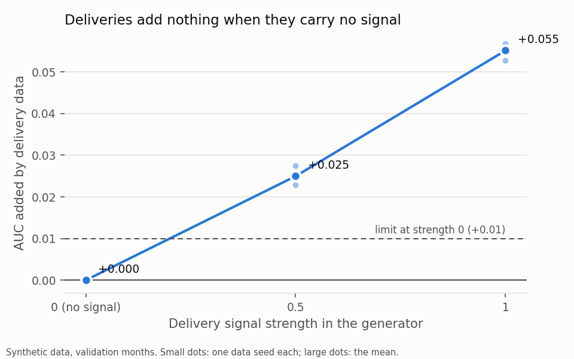

# Ablation on synthetic data

Written by `python -m src.model.ablation`. Validation months only; synthetic data.
Seeds: 42, 7, 123. Model: logistic regression, as the headline model.

## Mean validation AUC over the seeds

| Delivery signal strength | A purchases | B + payments | C + deliveries | D + questionnaire |
|---|---|---|---|---|
| 0.0 | 0.678 | 0.701 | 0.701 | 0.727 |
| 0.5 | 0.678 | 0.701 | 0.726 | 0.743 |
| 1.0 | 0.678 | 0.701 | 0.756 | 0.765 |

## What each group adds (paired AUC gain; mean, and lowest to highest over seeds)

| Delivery signal strength | Payments (B over A) | Deliveries (C over B) | Questionnaire (D over C) |
|---|---|---|---|
| 0.0 | +0.0225 (+0.0198 to +0.0242) | +0.0000 (-0.0003 to +0.0004) | +0.0260 (+0.0213 to +0.0317) |
| 0.5 | +0.0225 (+0.0198 to +0.0242) | +0.0250 (+0.0229 to +0.0275) | +0.0176 (+0.0136 to +0.0228) |
| 1.0 | +0.0225 (+0.0198 to +0.0242) | +0.0551 (+0.0528 to +0.0568) | +0.0089 (+0.0065 to +0.0115) |

## Negative control

At delivery signal strength 0, deliveries may add at most 0.01 AUC (the point gain, in every seed). Result: **PASSED** (seed 42: +0.0004, seed 7: -0.0001, seed 123: -0.0003).

## How to read this

- The delivery gain grows with the signal the generator puts in, and is about zero when it puts in none. That shows the pipeline measures what is there and does not invent signal. It does not show how much REDX data would add for real merchants: the generator decides that here, and only partner data can answer it.
- The questionnaire (D) adds signal because the generator ties its answers to how reliable a merchant is. It is still never in the headline model: answers are self-reported, easy to game once they move a score, and only 40% of merchants answered. It is shown beside the score instead.
